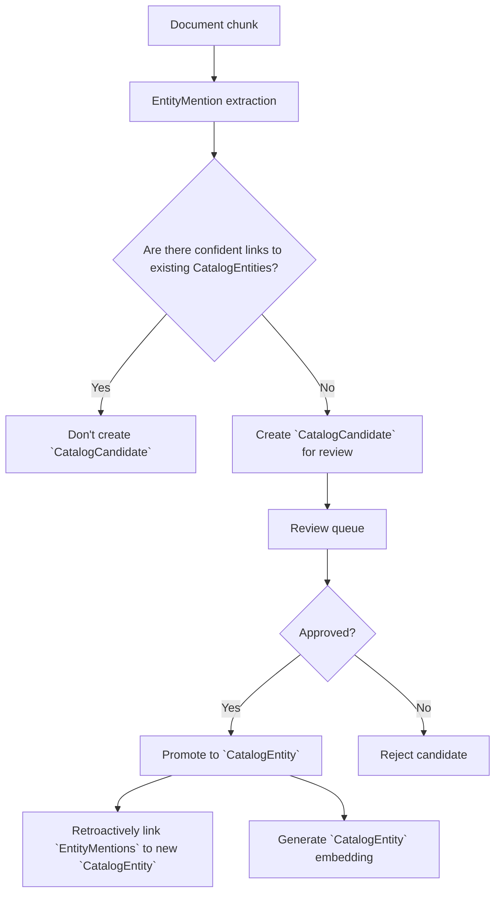

`EntityCatalog` - a catalog of known entities that we trust and want to track. Each `CatalogEntity` has a unique ID, canonical name, type, and metadata. We resolve `EntityMentions` to `CatalogEntity`s when possible.

`CatalogEntity` - is a person, organization, policy that pertains to something in the world. It's a unique thing that we want to track across documents and over time. Examples: "Clean Air Act", "EPA", "California". The `CatalogEntity` is the canonical representation. It is not an ambiguous mention in text, like "government" or "the law". It is the resolved entity that we want to link mentions to.

`EntityMention` - is a specific mention of an entity in a document. It has a span, text, type, and may be linked to `CatalogEntitys` with a confidence score that indicates how likely the `CatalogEntity` is the correct resolution for that mention. Examples: "augov" (which should link to "Australian Government").

`CatalogCandidate` - is an EntityMention that we are considering for promotion to the Catalog. It is never auto-promoted to the catalog and will go through an audit process through a UI to be promoted to a `CatalogEntity`. It has metadata about the mention and the candidate links to existing CatalogEntities.

`CatalogCandidate` can be merged with other `CatalogCandidate` records that are determined to be the same underlying entity mention. This allows us to consolidate review efforts and avoid duplicate candidates for the same entity mention.

`CatalogCandidate`s can be promoted to CatalogEntities after review. During promotion, we can assign a canonical name, type, and metadata to the new `CatalogEntity` based on the evidence from the mention and any linked candidates.

Once a `CatalogCandidate` is promoted to a `CatalogEntity`, all `EntityMentions` that were linked to that candidate can be retroactively linked to the new `CatalogEntity`, improving resolution quality over time.

Once a `CatalogCandidate` is promoted to a `CatalogEntity`, an embedding should be generated such that we can use similarity search to link future `EntityMentions` to that `CatalogEntity`. As more metadata information is added to the `CatalogEntity`, the embedding should be updated to improve retrieval quality.

`CatalogEntity`s can also be added externally, for example, if we want to add all parliamentary candidates and policies as entities, we can bulk import them as `CatalogEntity`s without going through the candidate review process. This allows us to bootstrap the catalog with known important entities that we want to track, even if they haven't been mentioned in the documents we've processed yet.

So the `EntityCatalog` is kind of like wikipedia of entities that we care about. We want to link mentions in documents to the wikipedia page of the entity, and we want to add new pages to the wikipedia when we find important entities that aren't already in there. The `CatalogCandidate` is like a proposed wikipedia page that needs to be reviewed before it gets added to the wikipedia. The `EntityMention` is like a hyperlink in a document that points to a wikipedia page.

Want to make:

1. UI that assists with reviewing `CatalogCandidate`s and promoting them to `CatalogEntity`s.
- the UI should list `CatalogCandidate`s in a way that it is easy to delete (soft) or merge duplicates, and to review the evidence for the candidate (mention text, type, linked candidates and their metadata/confidence, context of the mention in the document chunk).
- It should also be easy to Promote a `CatalogCandidate` to a `CatalogEntity`, and during promotion, the reviewer should be able to edit the canonical name, type, and metadata of the new `CatalogEntity` before it is added to the catalog.
- Once a `CatalogCandidate` is promoted to a `CatalogEntity`, the system should automatically link all `EntityMentions` that were linked to that candidate to the new `CatalogEntity`, and generate an embedding for the new `CatalogEntity` to improve future retrieval.
