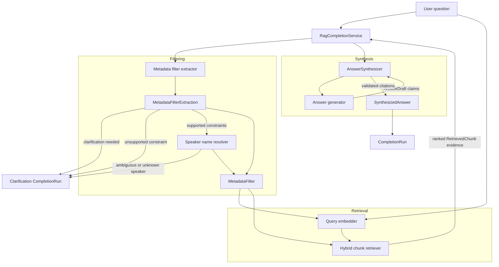

# Completion bounded context

The `completion` package implements the application capability of turning a
user's question into a grounded answer about parliamentary speech. Its central
use case coordinates three steps:

1. Interpret the question for metadata constraints.
2. Retrieve ranked speech chunks that satisfy those constraints.
3. Generate answer claims from the retrieved evidence and attach citations.

The completion package is one bounded context. `filtering/`, `retrieval/`, and
`synthesis/` are collaborating parts of that context, not separate bounded
contexts: they share the question, filter, chunk, and citation concepts and
participate in one user-facing use case. The surrounding application can call
the completion service without depending on the provider or persistence
implementations.

## Request flow

`RagCompletionService.retrieve()` stops after filtered evidence retrieval and
returns ranked chunks. `RagCompletionService.completion()` continues through
answer synthesis and returns a `CompletionRun`. Clarification and unsupported
filter conditions are converted into a clarification run; provider and
infrastructure failures are not silently converted into answers.

## Package map

| Area | Modules | Responsibility |
| --- | --- | --- |
| Use-case orchestration | `service_layer.py` | `RagCompletionService` owns the request sequence: extract filters, resolve speaker names, embed the question, retrieve chunks, then synthesize an answer. `CompletionRun` represents either an answer or a clarification. |
| Filter language and contracts | `filtering/metadata_filters.py` | Defines `MetadataFilter`, the `MetadataFilterExtraction` Pydantic model, its consistency rules, and the JSON schema supplied to structured-output providers. |
| Filter extraction adapters | `filtering/metadata_filter_extractor.py` | Defines the `AbstractMetadataFilterExtractor` port and the Ollama and OpenAI implementations. The adapter returns structured filter intent; the service decides how to apply it. |
| Filter-name resolution | `filtering/resolvers/speaker_name_resolver.py` | Defines the speaker-resolution contract and result. `MongoTalkerNameResolver` resolves names against the talker repository and asks for clarification if a name is missing or ambiguous. |
| Bill resolution | `filtering/resolvers/bill_name_resolver.py` | Defines the bill resolver port and result plus `MongoBillNameResolver`, which resolves canonical, shortened, abbreviated, or slightly misspelled names against the Hansard bill catalog. The completion service does not yet invoke it. |
| Retrieval contracts and query embedding | `retrieval/service_layer.py` | Defines `RetrievedChunk`, `QueryEmbedder`, `HybridChunkRetriever`, and `ChunkIdentityIndex`. `embed_query()` validates the embedding result, and retrieval helpers connect an embedding to the retriever. |
| SQLite retrieval adapter | `retrieval/sqlite_retrieval.py` | Implements vector search, FTS5/BM25 search, metadata filtering, and reciprocal-rank fusion behind the retrieval contract. It also checks whether annotated chunk IDs remain in the corpus. |
| Retrieval evaluation | `retrieval/evaluation.py` | Validates reviewed query/evidence cases, runs them through the completion service's retrieval path, records ranks and retrieved chunk details, and appends JSONL results for later review. |
| Answer and evidence models | `synthesis/models.py` | Defines evidence and answer-domain shapes: `EvidenceChunk`, `AnswerClaim`, `AnswerDraft`, `AnswerCitation`, and `SynthesizedAnswer`. Pydantic validation protects the generated claim/abstention contract. |
| Answer orchestration | `synthesis/answer_synthesizer.py` | Calls a generator with the retrieved evidence, verifies every citation refers to retrieved chunks, and renders answer text and source citations. |
| Generator port and shared output contract | `synthesis/generators/base_generator.py` | Defines `AbstractAnswerGenerator`, the shared system prompt, and the provider response schema. |
| Generator adapters | `synthesis/generators/ollama_generator.py`, `synthesis/generators/openai_generator.py` | Translate the generator port into Ollama or OpenAI requests and validate their structured responses as `AnswerDraft`. |

`__init__.py` files are package markers; the generator package also exposes
its provider adapters as a small public package surface.

## DDD boundaries and dependency direction

- **Application service:** `RagCompletionService` coordinates one use case. It
  should remain responsible for ordering and translating outcomes, not for
  provider protocols or SQL details.
- **Ports and domain-facing contracts:** The extractor, resolver, embedder,
  retriever, generator, and chunk protocols describe what the use case needs.
  Result models such as `MetadataFilter`, `RetrievedChunk`, and `AnswerDraft`
  keep those interactions expressed in completion language.
- **Adapters:** Ollama/OpenAI clients, the Mongo-backed speaker resolver, and
  `SQLiteHybridRetriever` translate external services or storage into those
  contracts. They should remain replaceable without changing the use case.
- **Trust boundary:** Retrieved text and metadata are evidence, not
  instructions. Generated claims are checked against the retrieved chunk IDs
  before citations are rendered.

The package is not wholly framework-independent today. Its contracts and
service are fairly focused, but `MetadataFilterExtraction` and answer models
use Pydantic, and the retrieval contracts expose Torch's `Tensor` type. These
are useful implementation choices, but they couple the inner modules to
specific libraries.

## Improvement opportunities

1. **Finish bill filtering as a vertical slice.** `MongoBillNameResolver` now
   resolves a title to a catalog ID, but the extraction model and
   `RagCompletionService` do not yet extract or resolve bill names, and the
   filter's `is_empty` check does not account for bill IDs. Complete the flow
   by extracting bill names, resolving them, applying the IDs during retrieval,
   and testing the behavior end to end. The current matcher is lexical; a
   maintained alias catalog may be needed for colloquial names that do not
   share words with the official title.
2. **Separate ports from provider concerns more explicitly.** The answer
   generator port, prompt, and provider JSON schema currently share
   `generators/base_generator.py`. Keeping the port independent and moving
   prompt/schema details to an adapter-facing module would make the inward
   dependency direction easier to maintain.
3. **Use one canonical provenance model.** `SQLiteChunkResult` carries
   metadata as a serialized string, and citation rendering interprets that
   string and parses date/house/chamber from a source-document ID. A typed
   provenance value created at the retrieval boundary would reduce repeated
   parsing and make citation rules easier to test.
4. **Clarify completion telemetry.** `CompletionRun` is documented as
   containing stage timings, but currently stores only the answer,
   evidence count, and optional clarification. Either add explicit timing data
   through a stable result type or update the description and keep
   observability separate from the domain result.
5. **Keep evaluation concerns at the edge.** Retrieval evaluation and JSONL
   persistence currently live beside production retrieval contracts. If
   evaluation tooling grows, move case fixtures/reporting to a separate
   evaluation or tooling module that depends on the completion ports, not the
   other way around.