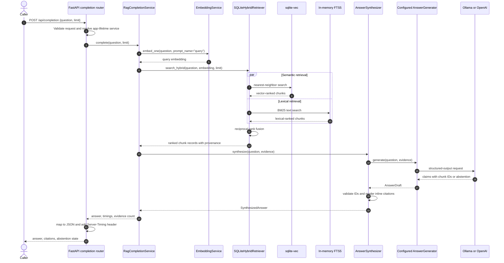

# RAG completion request flow

This document describes the current implementation of `POST /api/completion`,
from application startup through the HTTP response. The development roadmap is
in [RAG_SYSTEM_DEVELOPMENT_PLAN.md](./RAG_SYSTEM_DEVELOPMENT_PLAN.md).

## Request sequence

## Startup and dependency wiring

The composition root is [`ddd_policy_tracer/app.py`](../ddd_policy_tracer/app.py).
During FastAPI lifespan startup it:

1. Loads the repository-root `.env` without overriding process environment
   variables.
2. Gets the shared `EmbeddingService` singleton.
3. Opens the configured SQLite database and constructs one
   `SQLiteHybridRetriever`. Its in-memory FTS5 index is populated from
   `document_chunks` at construction; vector queries read from the same
   database.
4. Selects an answer-generation adapter using `RAG_ANSWER_GENERATOR`, then
   constructs `AnswerSynthesizer` and `RagCompletionService`.
5. Publishes the completion use case on FastAPI application lifespan state.
   The retriever is closed during shutdown.

The generator setting accepts `ollama` or `openai`; `ollama` is the current
default. See [README.md](../README.md#question-completion-api) for environment
configuration.

## Module responsibilities

| Module | Responsibility |
|---|---|
| [`app.py`](../ddd_policy_tracer/app.py) | Composition root: load environment, create shared resources, choose generator, register routers, and close the retriever. |
| [`api/completion.py`](../ddd_policy_tracer/api/completion.py) | HTTP adapter: validate request fields, resolve the use case, map expected provider/input failures, serialize the response, and report timings. |
| [`answering/completion_service.py`](../ddd_policy_tracer/answering/completion_service.py) | Use-case orchestration: time query embedding, hybrid retrieval, and answer synthesis separately. |
| [`retrieval/service_layer.py`](../ddd_policy_tracer/retrieval/service_layer.py) | Validate and embed the question, then return ranked evidence records with citation provenance intact. |
| [`retrieval/sqlite_retrieval.py`](../ddd_policy_tracer/retrieval/sqlite_retrieval.py) | Adapter for sqlite-vec and FTS5 search; fuses their rankings with reciprocal-rank fusion. |
| [`answering/service_layer.py`](../ddd_policy_tracer/answering/service_layer.py) | Generator port and answer domain types; `AnswerSynthesizer` validates chunk references, handles abstention, and renders citations from evidence. |
| [`answering/ollama_generator.py`](../ddd_policy_tracer/answering/ollama_generator.py) | Local Ollama adapter for structured claims and abstention. |
| [`answering/openai_generator.py`](../ddd_policy_tracer/answering/openai_generator.py) | OpenAI adapter for the same structured answer-generation contract. |
| [`answering/structured_output.py`](../ddd_policy_tracer/answering/structured_output.py) | Shared model instructions, structured-output schema, and response validation for both adapters. |

## Data contracts through the request

### Input

`CompletionRequest` accepts:

- `question`: trimmed non-empty text, at most 4,000 characters.
- `limit`: number of final evidence chunks, from 1 to 50; defaults to 10.

### Retrieved evidence

The completion use case passes the full ranked `SQLiteChunkResult` sequence to
the synthesizer. Each record includes `chunk_id`, `chunk_text`,
`source_document_id`, speaker metadata, and retrieval scores. Keeping the full
record is important: the generator sees the evidence IDs and passage content,
and the synthesizer uses stored metadata to build citations.

The hybrid retriever searches vector and lexical candidates separately. Its
candidate limit defaults to `max(30, limit * 3)`, then reciprocal-rank fusion
produces the requested final `limit`.

### Generated draft and citations

Each generator returns an `AnswerDraft` containing either:

- one or more claims, each with one or more `evidence_chunk_ids`; or
- an explicit abstention with a reason and no claims.

`AnswerSynthesizer` rejects claims without evidence and references to IDs that
were not retrieved. It assigns inline citation numbers in first-reference
order. Citation labels, including speaker and speech context when available,
are built from the stored evidence record, never from model-authored source
details. The returned citation object also retains the exact supporting
passage.

If retrieval returns no evidence, synthesis abstains without calling a model.
Otherwise the model may abstain if the provided passages do not support an
answer. A syntactically valid citation only proves that the chunk was
retrieved; semantic support still requires answer evaluation.

### HTTP response

`CompletionResponse` contains:

- `answer`: rendered text with inline `[n]` references and a source list.
- `citations`: numbered chunk IDs, source IDs, passages, and available
  speaker/date/house/chamber provenance.
- `abstained` and `abstention_reason`.

Expected input errors return HTTP 400. Provider connection/API failures return
HTTP 503. Unexpected failures (for example database or index errors) are not
silently converted into successful answers.

## Timing and observation

The completion use case records:

- `embedding_ms`: query embedding.
- `hybrid_retrieval_ms`: vector search, BM25, and rank fusion.
- `generation_ms`: generator call plus answer validation and citation
  synthesis.

Successful responses expose these values and total completion-handler time in
the `Server-Timing` header. The application log records the same stage
durations, retrieved evidence count, and abstention status without logging the
question or passages. See [Profiling completion requests](../README.md#profiling-completion-requests)
for a `curl` example.
