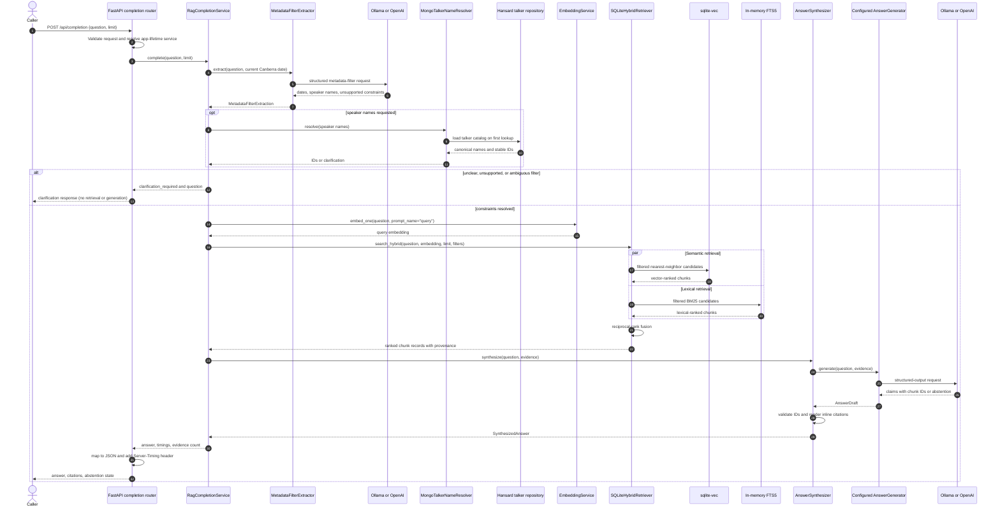

# RAG completion request flow

This document describes the current implementation of `POST /api/completion`,
from application startup through the HTTP response. The development roadmap is
in [RAG_SYSTEM_DEVELOPMENT_PLAN.md](./RAG_SYSTEM_DEVELOPMENT_PLAN.md).

## Request sequence

## Startup and dependency wiring

The composition root is [`ddd_policy_tracer/app.py`](../ddd_policy_tracer/app.py).
During FastAPI lifespan startup it:

1. Loads the repository-root `.env` without overriding process environment
   variables.
2. Gets the shared `EmbeddingService` singleton.
3. Opens the configured SQLite database and constructs one
   `SQLiteHybridRetriever`. Its in-memory FTS5 index is populated from
   `document_chunks` at construction; vector queries read from the same
   database.
4. Selects matching metadata-extraction and answer-generation adapters using
   `RAG_ANSWER_GENERATOR`, and constructs the `MongoTalkerNameResolver`. The
   Mongo talker catalog itself is loaded lazily, only when speaker filtering is
   requested.
5. Publishes the completion use case on FastAPI application lifespan state.
   The retriever and Mongo client are closed during shutdown.

The generator setting accepts `ollama` or `openai`; `ollama` is the current
default. Set `MONGODB_URI` and `HANSARD_MONGO_DATABASE` for speaker resolution;
their defaults are `mongodb://localhost:27017` and `hansard`. See
[README.md](../README.md#question-completion-api) for environment configuration.

## Module responsibilities

| Module | Responsibility |
|---|---|
| [`app.py`](../ddd_policy_tracer/app.py) | Composition root: load environment, create shared resources, choose generator, register routers, and close the retriever. |
| [`api/completion.py`](../ddd_policy_tracer/api/completion.py) | HTTP adapter: validate request fields, resolve the use case, map expected provider/input failures, serialize the response, and report timings. |
| [`answering/completion_service.py`](../ddd_policy_tracer/answering/completion_service.py) | Use-case orchestration: extract and resolve filters before query embedding, then time retrieval and synthesis. |
| [`answering/metadata_filter_extractor.py`](../ddd_policy_tracer/answering/metadata_filter_extractor.py) | Ollama and OpenAI structured-output adapters for filter extraction. |
| [`retrieval/metadata_filters.py`](../ddd_policy_tracer/retrieval/metadata_filters.py) | Typed date/speaker filter contract, extraction output validation, and Canberra-to-UTC range conversion. |
| [`retrieval/speaker_resolution.py`](../ddd_policy_tracer/retrieval/speaker_resolution.py) | Lazily cache the Hansard talker catalog and resolve unambiguous names to stable IDs. |
| [`retrieval/service_layer.py`](../ddd_policy_tracer/retrieval/service_layer.py) | Validate and embed the question, then return ranked evidence records with citation provenance intact. |
| [`retrieval/sqlite_retrieval.py`](../ddd_policy_tracer/retrieval/sqlite_retrieval.py) | Apply speaker/date constraints before sqlite-vec and FTS5 candidate limits, then fuse rankings. |
| [`answering/service_layer.py`](../ddd_policy_tracer/answering/service_layer.py) | Generator port and answer domain types; `AnswerSynthesizer` validates chunk references, handles abstention, and renders citations from evidence. |
| [`answering/ollama_generator.py`](../ddd_policy_tracer/answering/ollama_generator.py) | Local Ollama adapter for structured claims and abstention. |
| [`answering/openai_generator.py`](../ddd_policy_tracer/answering/openai_generator.py) | OpenAI adapter for the same structured answer-generation contract. |
| [`answering/structured_output.py`](../ddd_policy_tracer/answering/structured_output.py) | Shared model instructions, structured-output schema, and response validation for both adapters. |

## Data contracts through the request

### Input

`CompletionRequest` accepts:

- `question`: trimmed non-empty text, at most 4,000 characters.
- `limit`: number of final evidence chunks, from 1 to 50; defaults to 10.

### Retrieved evidence

The completion use case passes the full ranked `SQLiteChunkResult` sequence to
the synthesizer. Each record includes `chunk_id`, `chunk_text`,
`source_document_id`, speaker metadata, and retrieval scores. Keeping the full
record is important: the generator sees the evidence IDs and passage content,
and the synthesizer uses stored metadata to build citations.

The hybrid retriever searches vector and lexical candidates separately. Its
candidate limit defaults to `max(30, limit * 3)`, then reciprocal-rank fusion
produces the requested final `limit`.

Every completion runs one structured filter-extraction request through the
configured Ollama or OpenAI provider. V1 supports speaker and date/date-range
filters. Multiple speakers are ORed; date and speaker dimensions are ANDed.
Dates use inclusive Australia/Canberra calendar days, converted to UTC bounds
for storage comparisons. Relative periods are resolved against the current
Canberra date. The original question remains unchanged for embedding, lexical
retrieval, and answer generation.

Speaker names are matched against canonical, first-and-last, or unique
last-name forms. An unknown or ambiguous speaker, an explicitly requested
unsupported metadata constraint, or unclear filter intent returns a
clarification response before embedding or retrieval. Empty filtered results
remain empty and follow the normal answer abstention path; retrieval never
retries without the requested constraints.

### Generated draft and citations

Each generator returns an `AnswerDraft` containing either:

- one or more claims, each with one or more `evidence_chunk_ids`; or
- an explicit abstention with a reason and no claims.

`AnswerSynthesizer` rejects claims without evidence and references to IDs that
were not retrieved. It assigns inline citation numbers in first-reference
order. Citation labels, including speaker and speech context when available,
are built from the stored evidence record, never from model-authored source
details. The returned citation object also retains the exact supporting
passage.

If retrieval returns no evidence, synthesis abstains without calling a model.
Otherwise the model may abstain if the provided passages do not support an
answer. A syntactically valid citation only proves that the chunk was
retrieved; semantic support still requires answer evaluation.

### HTTP response

`CompletionResponse` contains:

- `answer`: rendered text with inline `[n]` references and a source list, or
  `null` when clarification is required.
- `citations`: numbered chunk IDs, source IDs, passages, and available
  speaker/date/house/chamber provenance.
- `abstained` and `abstention_reason`.
- `clarification_required` and `clarification_question` when metadata intent
  cannot safely be applied.

Expected input errors return HTTP 400. Invalid structured filter output returns
HTTP 502; provider or Mongo connection/API failures return HTTP 503. Unexpected
failures (for example database or index errors) are not silently converted
into successful answers.

## Timing and observation

The completion use case records:

- `metadata_filter_ms`: structured extraction and any speaker-name resolution.
- `embedding_ms`: query embedding.
- `hybrid_retrieval_ms`: vector search, BM25, and rank fusion.
- `generation_ms`: generator call plus answer validation and citation
  synthesis.

Responses expose these values and total completion-handler time in the
`Server-Timing` header. The application log records the same stage durations,
retrieved evidence count, abstention status, and clarification status without
logging the question or passages. See
[Profiling completion requests](../README.md#profiling-completion-requests) for
a `curl` example.
