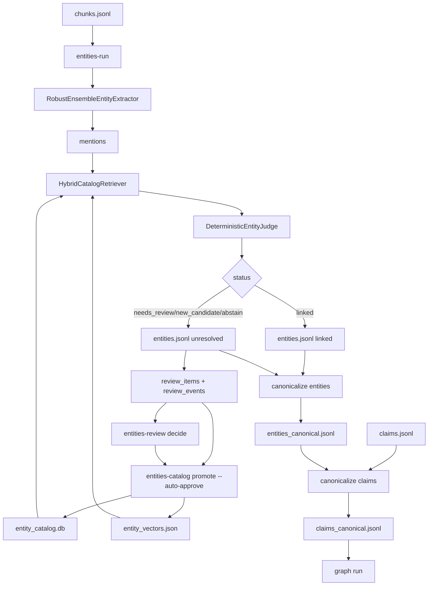

# Workflow Overview

This page explains the entities system in plain language.

## Core philosophy

The system separates concerns:

1. **Extract mentions from text** (what appears in documents)
2. **Resolve mentions to known entities** (what we already trust)
3. **Review uncertain cases** (human or policy-assisted)
4. **Promote confirmed entities back into the catalog**

That loop improves resolution quality over time.

## Source of truth

- `entity_catalog.db` is the runtime source of truth for known entities.
- `entity_vectors.json` is the retrieval sidecar built from the catalog.
- New runs use both to decide whether each mention is already known.

## End-to-end flow

## What statuses mean

- `linked`: top retrieved candidate confidence meets link threshold.
- `needs_review`: candidate confidence is between new-candidate and link thresholds.
- `new_candidate`: top retrieved candidate confidence is below new-candidate threshold.
- `abstain`: no candidates or ineligible/noisy mention.

## Probabilistic retrieval-first flow

- Retrieval returns a ranked set of candidate catalog entities with confidence scores.
- Mention metadata stores `candidate_links` and `max_candidate_score`.
- The judge currently applies threshold-only policy on `max_candidate_score`.
- Future judge policies can layer additional rules without changing retrieval contracts.

## Catalog eligibility gate

- Catalog curation only applies to `PERSON`, `ORG`, and `JURISDICTION` mentions.
- `POLICY` and `PROGRAM` mentions remain in extraction outputs for downstream analysis.
- Mentions with numeric/noisy or generic ambiguous surfaces (for example `Government`) are marked ineligible.

## Human review model

- **Human-in-the-loop required**: pending catalog-eligible items require explicit operator decisions.
- Interactive flow uses `entities-review curate` for one-by-one decisions.
- Manual decisions update canonical fields directly on `review_items`.

## Runtime modes

### Extraction only

No catalog paths provided:

- mention extraction runs
- no resolution statuses from catalog matching
- no review queue writes

### Extraction + resolution

Catalog and vectors provided:

- mention resolution runs
- statuses are written to metadata
- unresolved items are queued in review DB (if `--review-db-path` provided)

## Important downstream rule

In claim canonicalization:

- only `linked` entities become immediate `linked_entities`
- unresolved links are stored as `pending_entity_links`
